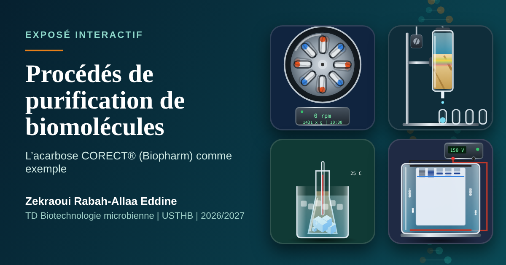

# Procédés de purification de biomolécules 🧬

An interactive bilingual learning website about downstream processing
and the purification of biomolecules. Created by Zekraoui Rabah-Allaa
Eddine, with an academic context at the Université des Sciences et de la
Technologie Houari Boumediene (USTHB), Algeria.

The site combines illustrated explanations, animated process diagrams,
virtual laboratory models, and downloadable study materials to help
university students explore the main stages and techniques used in
biomolecule purification.

## Explore the website

-   **Fundamentals**  Biomolecule categories, purification
    objectives, and the main product- and process-related impurities.
-   **Purification techniques** Interactive explanations and
    technical sheets for seven core techniques: centrifugation,
    filtration, precipitation, liquid-liquid extraction, chromatography,
    crystallization, and electrophoresis.
-   **Process stages**  Follow the downstream purification workflow,
    from clarification and capture to intermediate purification,
    polishing, and final preparation.
-   **Animated illustrations**  Visual explanations of the techniques
    and the journey of a molecule through a purification process.
-   **Virtual laboratory**  Interactive equipment models and
    adjustable parameters for the seven core techniques, plus advanced
    models for monolith chromatography, aqueous two-phase systems, and
    continuous chromatography.
-   **Build-a-process challenge** Assemble a purification sequence
    for a selected example and explore the simulated effects on purity,
    yield, and cost. The challenge uses illustrative teaching values,
    not validated industrial process data.
-   **Advanced topics**  Explore advanced purification approaches,
    impurity control, quality-control concepts, and product profiles.
-   **Study and presentation resources** Presenter mode with speaker
    notes and a timer, a searchable command palette, and a QR-code
    section linked to the configured website address.
-   **Downloads** Word report, one-page PDF summary, PowerPoint
    summary, and A3 poster, with preview images.

## Features

-   French and English interface.
-   Responsive, interactive presentation-style layout.
-   Animated technique illustrations and a 3D-style molecular helix
    rendered in the browser.
-   Virtual laboratory models with adjustable parameters.
-   Presenter mode, speaker notes, presentation timer, and fullscreen
    support where the browser allows it.
-   Search palette (Ctrl+K, `/`, or the Search control).
-   Lightweight mode for reducing visual effects on less powerful
    devices.
-   Local persistence for selected interface preferences where browser
    storage is available.
-   Designed to run locally from the project folder and to be hosted as
    a static website on GitHub Pages.
-   No build step or third-party JavaScript package installation is
    required.

Some optional external destinations, such as YouTube search links,
require an internet connection. Browser storage and fullscreen behavior
depend on the browser and its permissions.

## License and contact

© 2026 Zekraoui Rabah-Allaa Eddine🦑. All rights reserved.

This project, including its source code, text, illustrations, and
documents, is protected by the rights stated in `LICENSE.txt`. No
copying, modification, redistribution, reproduction, or commercial use
is permitted without prior authorization from the copyright holder.

For permission, licensing, questions, or feedback, contact the author
through
[LinkedIn](https://www.linkedin.com/in/zekraouirabahallaaeddine).
